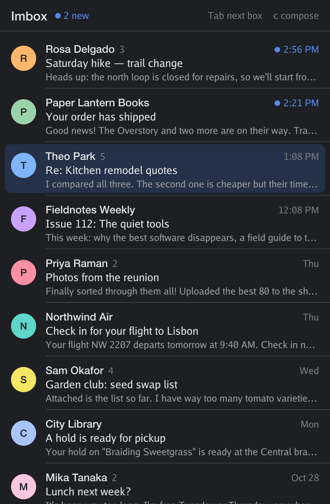
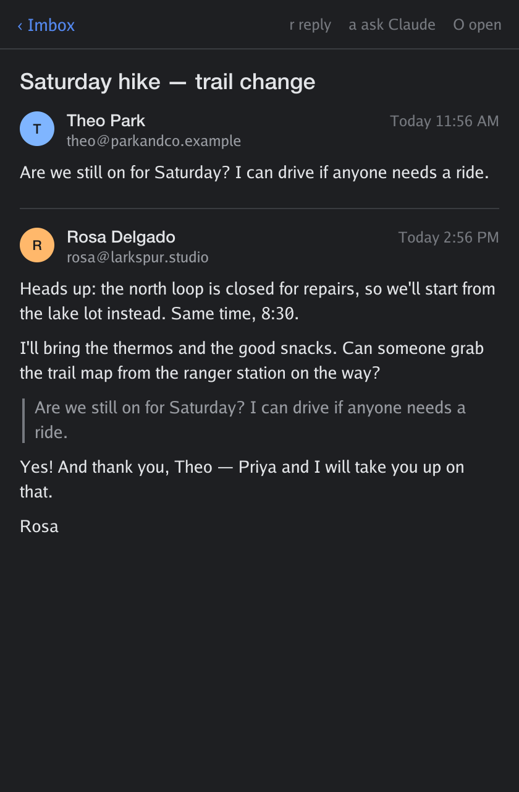
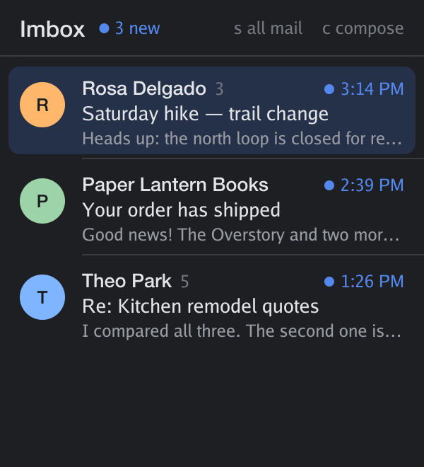

# heypad

**HEY mail, drawn in [Rex](https://superlogical.com).**

heypad is a small email client for [HEY](https://hey.com) that lives inside
Rex. It isn't a text UI: every screen is a real picture, sent with the kitty
graphics protocol and drawn at your display's pixel density, in your Rex
theme's colors. And it uses Rex itself for the rest of the app: mail floats
over whatever you're doing, replies open in floating panes, and Claude is one
key away for any thread.

<p align="center">
  
  
</p>

Floating, it shows only what's new, and it's just as happy in a slim pane:

<p align="center">
  
</p>

<sub>The screenshots show a made-up mailbox (`heypad render --demo`).</sub>

## What it does

- **Your boxes.** Imbox, The Feed, Paper Trail, Reply Later, Set Aside and
  Bubble Up. Tab between them, or press 1 to 6.
- **A reader built for mail.** Threads are laid out like a page, with rich
  text: headings, bold, italic and strikethrough, links you can click,
  lists, quotes with a bar, code in a monospace font, real tables, and the
  message's images. The clutter of marketing mail (tracking pixels, layout
  tables) is stripped out. `O` opens the original in HEY.
- **What's new, the way HEY sees it.** The Imbox shows HEY's own New For
  You and Previously Seen sections, and a blue dot marks everything you
  haven't opened. Open a thread and it's seen, in HEY too. The count shows in
  the header and the pane's title.
- **Aware of where it is.** The floating window shows only what's new, so a
  quick check is just that: work down the list to *All caught up*. A full
  window shows both sections. `s` switches.
- **Motion that costs nothing.** The list is uploaded once as a tall image and
  scrolled by moving the window onto it, and the selection is a separate
  small image underneath. Moving through mail sends a few bytes, not a frame.
  New threads glide in at the top, a thread rises into place as it opens, and
  edges fade where there's more to scroll.
- **Follows Rex.** Switch Rex's theme and heypad repaints to match. Look at
  the same pane from the iPad and it draws at the iPad's scale.

## Rex is the platform

heypad only runs in Rex, on purpose. Rex isn't just where it draws; it's what
the app is made of:

| | |
| --- | --- |
| **Floating mail** | `heypad float`, or **⌘⇧M** from any tab, shows HEY as a floating window over your work. Press it again (or Esc) and it tucks away. |
| **Floating compose** | `r` (reply) and `c` (new message) float a pane with your editor. You see what you wrote and choose send, edit, draft, or cancel. Nothing sends without that choice. The pane closes itself and the thread refreshes. |
| **Ask Claude** | `a` floats [Claude Code](https://claude.com/claude-code) over the window with the thread in hand: a summary, what you need to do, and a reply drafted for your approval. |
| **Triage with Claude** | `A` hands Claude all of New For You. Its verdicts (*Needs you*, *Worth a read*, *Skip*) appear on the rows in heypad as it writes them, and it marks threads seen only once you've approved which. |
| **Command palette** | *HEY: Toggle Mail*, *HEY: New Message*, *HEY: Open Mail Tab*. |
| **A pane beside you** | `heypad show` docks HEY next to your terminal, like a sidebar. |
| **Any machine** | It's plain Go, so it builds for Linux too. Run it on any host you reach through Rex and it draws in the Rex app in front of you. |

## Install

You need [Rex](https://superlogical.com), Go 1.27 or later, and the
[`hey` CLI](https://github.com/basecamp/hey-cli) signed in to your account.

```sh
git clone https://github.com/travelingflwr/heypad
cd heypad
make install          # builds ~/.local/bin/heypad
heypad rex-install --bind cmd+shift+m
```

`rex-install` writes `~/.config/rex/heypad.lua` with the palette actions and
the shortcut. Load it by adding this line to `~/.config/rex/init.lua`, then run
`rex config reload`:

```lua
pcall(require, "heypad")
```

For the exact look on a Mac, install the static **SF Pro** fonts from
[developer.apple.com/fonts](https://developer.apple.com/fonts/). Without them,
heypad uses Inter if it's installed, then Helvetica Neue.

## Use it

```sh
heypad float          # toggle the floating mail window
heypad show           # open HEY in a pane beside yours (--below, --ratio 40)
heypad view           # run it in this pane
```

| Key | |
| --- | --- |
| `j` `k` `↑` `↓` | move, or scroll a thread |
| `Enter` `o` | open the thread |
| `Esc` `h` | back to the list; on the list, clear marks or minimize the floating window |
| `Tab` `1`–`6` | switch boxes |
| `s` | in the Imbox, only what's new, or both sections |
| `x` | mark a thread (and move down) |
| `X` | mark this thread and every new one below it |
| `e` | mark seen: the marked threads, or this one, after a yes |
| `A` | triage New For You with Claude |
| `n` `p` | next or previous thread |
| `r` | reply |
| `c` | new message |
| `a` | ask Claude about the thread |
| `O` | open the thread in HEY |
| `R` | refresh |
| `q` | quit |

Clicking a thread opens it; clicking the header goes back.

## How it works

- **The Imbox's sections come from HEY's own ordering.** New For You and
  Previously Seen are each listed newest first, so where that order rises is
  where Previously Seen begins, and HEY's page cursor settles the case where
  everything is in one section (inbox zero, say).
- **Mail comes from the `hey` CLI's JSON**, and heypad keeps the last result
  of each box and thread on disk (`~/.local/state/heypad`), so it opens
  instantly and refreshes behind the scenes every 90 seconds.
- **Every screen is drawn in Go** with `golang.org/x/image`, then sent to Rex
  as zlib-compressed RGBA over the kitty graphics protocol.
- **Rex features are reached through the `rex` CLI** and its control API:
  `session.new_layer` for floating panes, `session.set_layer_state` to
  minimize and restore, and `rex wait` to learn when a compose pane closes.
  The palette actions are a short Lua module that calls the same API from
  inside the Rex server.

## Privacy and safety

- heypad talks only to HEY, through the `hey` CLI, and to Rex. It keeps
  cached mail in `~/.local/state/heypad` (readable only by you).
- **Images load only through HEY's image proxy** (`*.hey.com`), which
  doesn't tell senders you opened their mail or where you are. Images from
  anywhere else aren't fetched, and images embedded in the message always
  show. Loaded images are cached in `~/.local/state/heypad/images`.
- **Triage** gives Claude each new thread's sender, subject and preview,
  tells it to treat them as untrusted data, and lets it mark threads seen
  only after you approve exactly which. It can't send, reply, delete or move
  mail.
- **Ask Claude** writes the thread to a file in that folder and tells Claude
  to treat the email as untrusted data, never as instructions, and to send a
  reply only after you approve its exact text. Set `HEYPAD_AGENT` to use a
  different agent command.
- What's new comes from HEY itself, so it matches HEY on the web and your
  phone. Opening a thread in heypad marks it seen in HEY, as HEY's apps do.

## Credits

The kitty graphics plumbing, key decoder and edge fades come from
[rexpad](https://github.com/almonk/rexpad) by Alasdair Monk, the todo list
that showed what a Rex pane can be.

## License

[MIT](LICENSE)
